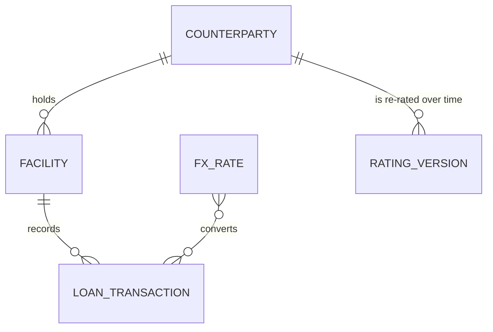

# Data model: wholesale lending exposure

## Conceptual

A **counterparty** (a corporate borrower) holds one or more **facilities** (committed
credit lines: term loans or revolvers). Each facility has a stream of **loan
transactions** (drawdowns, repayments, interest, fees). Exposure is the drawn
principal on each day, converted to the reporting currency (GBP) using daily **FX
rates**, and reported by the counterparty's sector and **internal rating as it was
at the time**.

## Logical (Kimball star)

| Table | Grain | Type | Keys |
|---|---|---|---|
| `dim_counterparty` | one row per counterparty **version** | SCD2 (dbt snapshot, `check` strategy on name, sector, country, rating) | `counterparty_sk` (surrogate), `counterparty_id` (natural), `valid_from`/`valid_to`, `is_current` |
| `dim_facility` | one row per facility | SCD1 | `facility_id` |
| `dim_date` | one row per calendar day | static | `date_day` |
| `fct_loan_transactions` | one row per transaction | transaction fact, incremental | `txn_id`; FKs `facility_id`, `counterparty_sk` (as-of value date) |
| `fct_facility_balance_daily` | facility × day while live | periodic snapshot fact, incremental | (`facility_id`, `balance_date`) |
| `mart_exposure_by_sector_rating` | month end × sector × rating | aggregate | (`month_end`, `sector`, `internal_rating`) |

Modelling decisions:

* **Point-in-time correctness.** Facts join the counterparty version valid on the
  value date (or balance date), so a downgrade in October does not rewrite
  September's exposure-by-rating report. Each counterparty's first version is
  back-dated to 1900-01-01 so history loaded before the first snapshot still
  resolves (enforced by a `not_null` + `relationships` test on `counterparty_sk`).
* **Principal vs income.** `principal_delta` (+drawdown / −repayment) drives balances.
  Interest and fees are kept in the transaction fact but never move principal.
* **Periodic snapshot fact.** Daily balances are materialised so month-end reporting is
  a filter, not a window over all history at query time.

## Physical (Snowflake)

| Layer | Database.Schema | Materialisation | Notes |
|---|---|---|---|
| Raw | `RAW.LENDING` | tables loaded by Snowpipe (auto-ingest from S3, Parquet) and COPY (CSV) | all columns `STRING` + load metadata, so a source type change never blocks ingestion |
| Staging | `LENDING.STAGING` | views | typing, trimming, de-duplication (`row_number` latest `loaded_at`) |
| Intermediate | `LENDING.INTERMEDIATE` | views | FX conversion, date-spine balance roll-forward |
| Marts | `LENDING.MARTS` | tables / incremental `MERGE` | `fct_*` incremental with a 3-day late-arrival lookback |
| Snapshots | `LENDING.SNAPSHOTS` | dbt snapshot | SCD2 history |
| Shared | `LENDING.SHARED` | Snowflake-managed **Iceberg** table on S3 | exposure mart readable by Athena/Spark |

Physical choices: `NUMBER(18,2)` money, widened to `NUMBER(38,10)` before FX
multiplication. The `TRANSFORM_WH` and `REPORTING_WH` warehouses auto-suspend after
60s. `tax_id` has a masking policy (visible to `CREDIT_RISK` only), and a row access
policy restricts counterparties by country entitlement.
